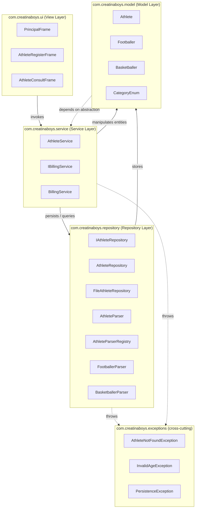

# Layers Diagram

The dashed arrow from the model to the service layer is a dependency on the
`IBillingService` **interface** only (Dependency Inversion Principle):
`Athlete.calculateFee(IBillingService)` never knows the concrete pricing rules.