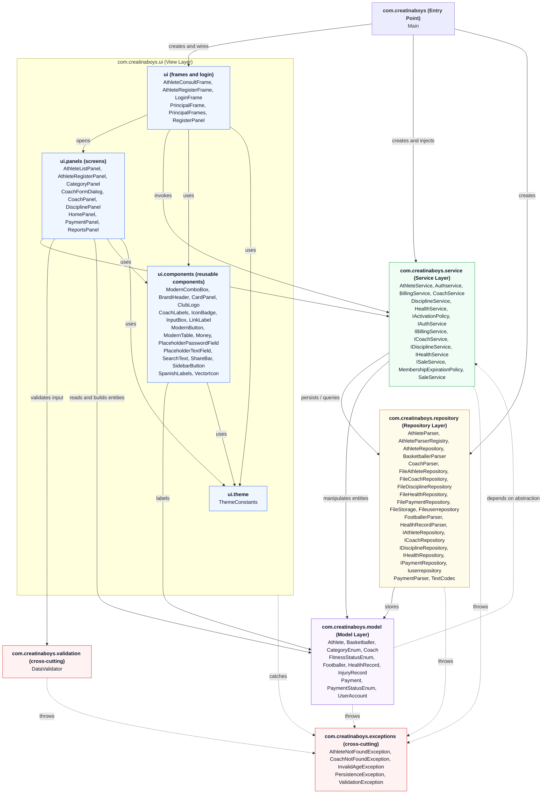

# Layers Diagram

Layered architecture of the project (`com.creatinaboys`). Every top-level class, interface and enum is placed in the package where it is **declared**; inner classes are listed in `class-diagram.md`. The arrows are the dependencies found in the source code between packages.

Each box lists every class, interface and enum declared in that package. Solid arrows are direct dependencies (creation, fields, calls); dashed arrows are dependencies on an abstraction or error propagation.

The dashed arrow from the model to the service layer is a dependency on the
`IBillingService` **interface** only (Dependency Inversion Principle):
`Athlete.calculateFee(IBillingService)` never knows the concrete pricing rules.

**Folder vs. package.** Three files are stored in a folder that does not match the package they declare, and the diagram uses the declared package: `RegisterPanel` is in `ui/panels/` but declares `com.creatinaboys.ui`; `ModernComboBox` is in `ui/Theme/` but declares `com.creatinaboys.ui.components`; `ThemeConstants` is in `ui/Theme/` and declares `com.creatinaboys.ui.theme`.

`SearchText` and `SpanishLabels` live in `ui.components`: `AthleteListPanel` and `CoachPanel` use them to normalize the search query
(no accents, no upper case) before filtering the lists returned by the service layer; the filtering never reaches the repository.