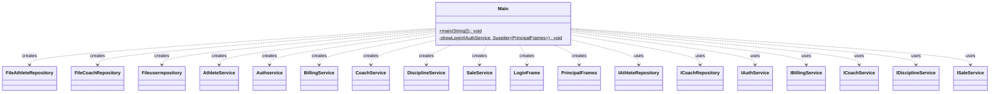

# Class Diagram

Complete class diagram of the project (`com.creatinaboys`), generated from the source code: every class, interface, enum and inner class is included. Because of its size it is split by layer, so each diagram stays readable. The sections follow the architecture: model, repository, service and UI.

**How to read it**

| Notation | Meaning |
| :-- | :-- |
| `A <\|-- B` | `B` extends `A` |
| `A <\|.. B` | `B` implements interface `A` |
| `A --> B` | `A` has a field of type `B` (association) |
| `A ..> B : creates / throws / uses` | `A` instantiates, throws or uses `B` |
| `A *-- B : inner class` | `B` is declared inside `A`; it is written `A_B` |
| `+` `-` `#` `~` | public, private, protected, package-private |
| `$` / `*` | static / abstract |

Classes drawn without members are only the end point of a relationship: they are described in the section of their own layer. Swing parents (`JPanel`, `JFrame`, ...) are shown in `hierarchy-diagram.md`. In the UI sections, constants and Swing fields are omitted.

## 1. Model, exceptions and validation

Domain entities and enums (`model`), custom exceptions (`exceptions`) and input validation (`validation`).

```mermaid
classDiagram
    direction TB
    class AthleteNotFoundException {
        <<checked>>
        -String searchedId
        +AthleteNotFoundException(String)
        +getSearchedId() String
    }
    class CoachNotFoundException {
        <<checked>>
        -String searchedId
        +CoachNotFoundException(String)
        +getSearchedId() String
    }
    class InvalidAgeException {
        <<checked>>
        -int enteredAge
        +InvalidAgeException(int)
        +getEnteredAge() int
    }
    class PersistenceException {
        <<unchecked>>
        +PersistenceException(String)
        +PersistenceException(String, Throwable)
    }
    class ValidationException {
        <<checked>>
        +ValidationException(String)
        +ValidationException(String, Throwable)
    }
    class Athlete {
        <<abstract>>
        +int MAX_AGE$
        -String id
        -String fullName
        -int age
        -String phone
        -int jerseyNumber
        -double monthlyFee
        -CategoryEnum category
        -boolean active
        -boolean manualOverride
        -LocalDate paidUntil
        #Athlete(String, String, int, String, int)
        +calculateFee(IBillingService)* void
        +getDiscipline()* String
        #requireValidAge(int)$ int
        #requireText(String, String)$ String
        +getId() String
        +setId(String) void
        +getFullName() String
        +setFullName(String) void
        +getAge() int
        +setAge(int) void
        +getPhone() String
        +setPhone(String) void
        +getJerseyNumber() int
        +setJerseyNumber(int) void
        +getMonthlyFee() double
        +setMonthlyFee(double) void
        +getCategory() CategoryEnum
        +setCategory(CategoryEnum) void
        +isActive() boolean
        +setActive(boolean) void
        +isManualOverride() boolean
        +setActiveManually(boolean) void
        +clearManualOverride() void
        +getPaidUntil() LocalDate
        +setPaidUntil(LocalDate) void
        +renewMembership(int) void
        +isMembershipExpired(int) boolean
        +equals(Object) boolean
        +hashCode() int
        +toString() String
    }
    class Basketballer {
        -double height
        +Basketballer(String, String, int, String, int, double)
        -requireValidHeight(double)$ double
        +calculateFee(IBillingService) void
        +getDiscipline() String
        +getHeight() double
        +setHeight(double) void
    }
    class CategoryEnum {
        <<enumeration>>
        CHILDREN
        YOUTH
        ADULTS
        -String name
        -CategoryEnum(String)
        +getName() String
        +toString() String
    }
    class Coach {
        -String id
        -String fullName
        -String phone
        -String discipline
        -CategoryEnum category
        -boolean active
        +Coach(String, String, String, String, CategoryEnum)
        +Coach(String, String, String, String, CategoryEnum, boolean)
        +getId() String
        +getFullName() String
        +setFullName(String) void
        +getPhone() String
        +setPhone(String) void
        +getDiscipline() String
        +setDiscipline(String) void
        +getCategory() CategoryEnum
        +setCategory(CategoryEnum) void
        +isActive() boolean
        +setActive(boolean) void
        +equals(Object) boolean
        +hashCode() int
        +toString() String
    }
    class FitnessStatusEnum {
        <<enumeration>>
        FIT
        FIT_WITH_RESTRICTIONS
        UNFIT
        -String description
        -FitnessStatusEnum(String)
        +getDescription() String
    }
    class Footballer {
        -String playingPosition
        +Footballer(String, String, int, String, int, String)
        +calculateFee(IBillingService) void
        +getDiscipline() String
        +getPlayingPosition() String
        +setPlayingPosition(String) void
    }
    class HealthRecord {
        -String athleteId
        -FitnessStatusEnum fitnessStatus
        -LocalDate assessmentDate
        -String restrictions
        -List~InjuryRecord~ injuries
        +HealthRecord(String, FitnessStatusEnum, LocalDate, String)
        +addInjury(InjuryRecord) void
        +updateFitnessStatus(FitnessStatusEnum, String, LocalDate) boolean
        +getAthleteId() String
        +getFitnessStatus() FitnessStatusEnum
        +setFitnessStatus(FitnessStatusEnum) void
        +getAssessmentDate() LocalDate
        +setAssessmentDate(LocalDate) void
        +getRestrictions() String
        +setRestrictions(String) void
        +getInjuries() List~InjuryRecord~
    }
    class InjuryRecord {
        -String DEFAULT_STATUS$
        -String id
        -String description
        -LocalDate date
        -String status
        -String observations
        +InjuryRecord(String, String, LocalDate, String, String)
        +getId() String
        +getDescription() String
        +setDescription(String) void
        +getDate() LocalDate
        +setDate(LocalDate) void
        +getStatus() String
        +setStatus(String) void
        +getObservations() String
        +setObservations(String) void
        +equals(Object) boolean
        +hashCode() int
    }
    class Payment {
        -String athleteId
        -double amount
        -LocalDate paymentDate
        -YearMonth period
        +Payment(String, double, LocalDate, YearMonth)
        +getAthleteId() String
        +getAmount() double
        +getPaymentDate() LocalDate
        +getPeriod() YearMonth
        +toString() String
    }
    class PaymentStatusEnum {
        <<enumeration>>
        PAID
        PARTIAL
        PENDING
        -double EPSILON$
        -String label
        -PaymentStatusEnum(String)
        +getLabel() String
        +of(double, double)$ PaymentStatusEnum
        +toString() String
    }
    class UserAccount {
        -String username
        -String salt
        -String passwordHash
        +UserAccount(String, String, String)
        +getUsername() String
        +getSalt() String
        +getPasswordHash() String
    }
    class DataValidator {
        <<utility>>
        +int MIN_AGE$
        +int MAX_AGE$
        +int MAX_JERSEY_NUMBER$
        +double MAX_HEIGHT_METERS$
        +double MIN_HEIGHT_METERS$
        -DataValidator()
        +validateRequiredString(String, String)$ void
        +validateId(String)$ void
        +validateFullName(String)$ void
        +validatePhone(String)$ void
        +validateRequiredPhone(String)$ void
        +parsePositiveInt(String, String)$ int
        +parseIntInRange(String, String, int, int)$ int
        +parseAge(String)$ int
        +parseJerseyNumber(String)$ int
        +parsePositiveDouble(String, String)$ double
        +parseHeight(String)$ double
    }

    Athlete <|-- Basketballer
    Athlete <|-- Footballer
    Athlete --> CategoryEnum
    Coach --> CategoryEnum
    HealthRecord --> FitnessStatusEnum
    HealthRecord --> InjuryRecord
    DataValidator ..> ValidationException : creates
    Athlete ..> InvalidAgeException : throws
    Basketballer ..> InvalidAgeException : throws
    Footballer ..> InvalidAgeException : throws
    Athlete ..> IBillingService : uses
    Basketballer ..> IBillingService : uses
    Footballer ..> IBillingService : uses
```

## 2. Repository layer

Repository interfaces, file-based implementations, parsers and the text helpers (`repository`).

```mermaid
classDiagram
    direction TB
    class AthleteParser {
        <<interface>>
        +getType() String
        +toTextLine(Athlete) String
        +fromTextFields(String[]) Athlete
    }
    class AthleteParserRegistry {
        -Map~String, AthleteParser~ readerMap
        -Map~Class, AthleteParser~ writerMap
        +register(Class, AthleteParser) AthleteParserRegistry
        +toTextLine(Athlete) String
        +fromTextLine(String, String[]) Athlete
        -findWriter(Class) AthleteParser
    }
    class AthleteRepository {
        -List~Athlete~ athleteList
        +save(Athlete) boolean
        +findById(String) Athlete
        +findAll() List~Athlete~
        +deleteById(String) boolean
        +update(Athlete) boolean
        -indexOf(String) int
    }
    class BasketballerParser {
        -String TYPE$
        -int FIELD_COUNT$
        +getType() String
        +toTextLine(Athlete) String
        +fromTextFields(String[]) Athlete
    }
    class CoachParser {
        -String TYPE$
        -int FIELD_COUNT$
        +toTextLine(Coach) String
        +fromTextFields(String[]) Coach
    }
    class FileAthleteRepository {
        -String DEFAULT_FILE_PATH$
        -String EXTRAS_MARK$
        -Path path
        -AthleteParserRegistry parsers
        +FileAthleteRepository()
        +FileAthleteRepository(String)
        +FileAthleteRepository(String, AthleteParserRegistry)
        -defaultParsers()$ AthleteParserRegistry
        +save(Athlete) boolean
        +findById(String) Athlete
        +findAll() List~Athlete~
        +deleteById(String) boolean
        +update(Athlete) boolean
        -saveAll(List~Athlete~) void
        -toLine(Athlete) String
        -parseLine(String) Athlete
        -applyExtras(Athlete, String) void
    }
    class FileCoachRepository {
        -String DEFAULT_FILE_PATH$
        -Path path
        -CoachParser parser
        +FileCoachRepository()
        +FileCoachRepository(String)
        +save(Coach) boolean
        +findById(String) Optional~Coach~
        +findAll() List~Coach~
        +findByDisciplineAndCategory(String, CategoryEnum) List~Coach~
        +deleteById(String) boolean
        +update(Coach) boolean
        -saveAll(List~Coach~) void
    }
    class FileDisciplineRepository {
        -String DEFAULT_FILE_PATH$
        -Path path
        +FileDisciplineRepository()
        +FileDisciplineRepository(String)
        +findAll() List~String~
        +saveAll(List~String~) void
    }
    class FileHealthRepository {
        -String DEFAULT_FILE_PATH$
        -Path path
        -HealthRecordParser parser
        +FileHealthRepository()
        +FileHealthRepository(String)
        +save(HealthRecord) boolean
        +findByAthleteId(String) Optional~HealthRecord~
        +findAll() List~HealthRecord~
        +deleteByAthleteId(String) boolean
        +update(HealthRecord) boolean
        -saveAll(List~HealthRecord~) void
    }
    class FilePaymentRepository {
        -String DEFAULT_FILE_PATH$
        -Path path
        -PaymentParser parser
        +FilePaymentRepository()
        +FilePaymentRepository(String)
        +save(Payment) boolean
        +findAll() List~Payment~
        +findByAthleteId(String) List~Payment~
    }
    class FileStorage {
        <<utility>>
        -Charset LEGACY_CHARSET$
        -FileStorage()
        ~readLines(Path)$ List~String~
        ~writeLines(Path, List~String~)$ void
        -backupOf(Path)$ Path
    }
    class Fileuserrepository {
        -String DEFAULT_FILE_PATH$
        -Path path
        +Fileuserrepository()
        +Fileuserrepository(String)
        +save(UserAccount) boolean
        +findByUsername(String) Optional~UserAccount~
        +findAll() List~UserAccount~
    }
    class FootballerParser {
        -String TYPE$
        -int FIELD_COUNT$
        +getType() String
        +toTextLine(Athlete) String
        +fromTextFields(String[]) Athlete
    }
    class HealthRecordParser {
        -String TYPE$
        -int FIELD_COUNT$
        +toTextLine(HealthRecord) String
        +fromTextFields(String[]) HealthRecord
    }
    class IAthleteRepository {
        <<interface>>
        +save(Athlete) boolean
        +findById(String) Athlete
        +findAll() List~Athlete~
        +deleteById(String) boolean
        +update(Athlete) boolean
    }
    class ICoachRepository {
        <<interface>>
        +save(Coach) boolean
        +findById(String) Optional~Coach~
        +findAll() List~Coach~
        +findByDisciplineAndCategory(String, CategoryEnum) List~Coach~
        +deleteById(String) boolean
        +update(Coach) boolean
    }
    class IDisciplineRepository {
        <<interface>>
        +findAll() List~String~
        +saveAll(List~String~) void
    }
    class IHealthRepository {
        <<interface>>
        +save(HealthRecord) boolean
        +findByAthleteId(String) Optional~HealthRecord~
        +findAll() List~HealthRecord~
        +deleteByAthleteId(String) boolean
        +update(HealthRecord) boolean
    }
    class IPaymentRepository {
        <<interface>>
        +save(Payment) boolean
        +findAll() List~Payment~
        +findByAthleteId(String) List~Payment~
    }
    class Iuserrepository {
        <<interface>>
        +save(UserAccount) boolean
        +findByUsername(String) Optional~UserAccount~
        +findAll() List~UserAccount~
    }
    class PaymentParser {
        -String TYPE$
        -int FIELD_COUNT$
        +toTextLine(Payment) String
        +fromTextFields(String[]) Payment
    }
    class TextCodec {
        <<utility>>
        ~String LEGACY_EMPTY$
        -String SPECIAL$
        -TextCodec()
        ~escape(String)$ String
        ~escapeOptional(String)$ String
        ~unescape(String)$ String
        ~unescapeOptional(String)$ String
        ~split(String, char)$ String[]
        ~requireFields(String[], int, String)$ void
    }

    IAthleteRepository <|.. AthleteRepository
    AthleteParser <|.. BasketballerParser
    IAthleteRepository <|.. FileAthleteRepository
    ICoachRepository <|.. FileCoachRepository
    IDisciplineRepository <|.. FileDisciplineRepository
    IHealthRepository <|.. FileHealthRepository
    IPaymentRepository <|.. FilePaymentRepository
    Iuserrepository <|.. Fileuserrepository
    AthleteParser <|.. FootballerParser
    AthleteParserRegistry --> AthleteParser
    AthleteRepository --> Athlete
    FileAthleteRepository --> AthleteParserRegistry
    FileCoachRepository --> CoachParser
    FileHealthRepository --> HealthRecordParser
    FilePaymentRepository --> PaymentParser
    AthleteParserRegistry ..> PersistenceException : creates
    AthleteRepository ..> AthleteNotFoundException : creates
    BasketballerParser ..> PersistenceException : creates
    BasketballerParser ..> Basketballer : creates
    CoachParser ..> PersistenceException : creates
    CoachParser ..> Coach : creates
    FileAthleteRepository ..> AthleteNotFoundException : creates
    FileAthleteRepository ..> BasketballerParser : creates
    FileAthleteRepository ..> FootballerParser : creates
    FileStorage ..> PersistenceException : creates
    Fileuserrepository ..> UserAccount : creates
    FootballerParser ..> PersistenceException : creates
    FootballerParser ..> Footballer : creates
    HealthRecordParser ..> PersistenceException : creates
    HealthRecordParser ..> HealthRecord : creates
    HealthRecordParser ..> InjuryRecord : creates
    PaymentParser ..> PersistenceException : creates
    PaymentParser ..> Payment : creates
    TextCodec ..> PersistenceException : creates
    FileCoachRepository ..> PersistenceException : throws
    FileDisciplineRepository ..> PersistenceException : throws
    FileHealthRepository ..> PersistenceException : throws
    FilePaymentRepository ..> PersistenceException : throws
    Fileuserrepository ..> PersistenceException : throws
    IAthleteRepository ..> AthleteNotFoundException : throws
    ICoachRepository ..> PersistenceException : throws
    IDisciplineRepository ..> PersistenceException : throws
    IHealthRepository ..> PersistenceException : throws
    IPaymentRepository ..> PersistenceException : throws
    Iuserrepository ..> PersistenceException : throws
    BasketballerParser ..> TextCodec : uses
    CoachParser ..> TextCodec : uses
    FileAthleteRepository ..> FileStorage : uses
    FileAthleteRepository ..> TextCodec : uses
    FileCoachRepository ..> FileStorage : uses
    FileCoachRepository ..> TextCodec : uses
    FileDisciplineRepository ..> FileStorage : uses
    FileHealthRepository ..> FileStorage : uses
    FileHealthRepository ..> TextCodec : uses
    FilePaymentRepository ..> FileStorage : uses
    FilePaymentRepository ..> TextCodec : uses
    Fileuserrepository ..> FileStorage : uses
    Fileuserrepository ..> TextCodec : uses
    FootballerParser ..> TextCodec : uses
    HealthRecordParser ..> TextCodec : uses
    PaymentParser ..> TextCodec : uses
```

## 3. Service layer

Business services, their interfaces and the activation policy (`service`).

```mermaid
classDiagram
    direction TB
    class AthleteService {
        -IAthleteRepository repository
        -IBillingService billingService
        +AthleteService(IAthleteRepository, IBillingService)
        +registerAthlete(Athlete) boolean
        +findAthlete(String) Athlete
        +getAllAthletes() List~Athlete~
        +deleteAthlete(String) boolean
        +getTotalAthletesCount() int
        +getAthletesCountByType(Class~T~) long
        +applyActivationPolicy(IActivationPolicy) void
        +toggleAthleteStatus(String) boolean
        +setAthleteActive(String, boolean) boolean
        +renewMembership(String, int) boolean
        -persist(Athlete) void
    }
    class Authservice {
        +String DEFAULT_USER$
        +String DEFAULT_PASSWORD$
        -int ITERATIONS$
        -int KEY_BITS$
        -int SALT_BYTES$
        -int USERNAME_MIN$
        -int USERNAME_MAX$
        -int PASSWORD_MIN$
        -Iuserrepository repository
        -SecureRandom random
        +Authservice(Iuserrepository)
        +ensureDefaultUser() void
        +authenticate(String, char[]) boolean
        +register(String, char[], char[]) void
        -hasLetterAndDigit(char[])$ boolean
        -createAccount(String, char[]) UserAccount
        -hash(char[], byte[])$ byte[]
    }
    class BillingService {
        +determineCategory(int) CategoryEnum
        +calculateFee(int) double
    }
    class CoachService {
        -ICoachRepository coachRepository
        +CoachService(ICoachRepository)
        +registerCoach(Coach) boolean
        +assignCoachToCategory(String, String, CategoryEnum) boolean
        +getAllCoaches() List~Coach~
        +findCoachById(String) Optional~Coach~
        +getCoachesByDiscipline(String) List~Coach~
        +getCoachesByCategory(CategoryEnum) List~Coach~
        +updateCoach(Coach) boolean
        +deleteCoach(String) boolean
        +getCoachesCountByDiscipline() Map~String, Long~
        +getTotalCoachesCount() int
        +toggleCoachStatus(String) boolean
    }
    class DisciplineService {
        -List~String~ DEFAULTS$
        -Map~String, String~ ALIASES$
        -List~String~ disciplines
        -IDisciplineRepository repository
        +DisciplineService()
        +DisciplineService(List~String~)
        +DisciplineService(IDisciplineRepository)
        -load(List~String~) int
        +getAvailableDisciplines() List~String~
        +registerDiscipline(String) boolean
        +isDisciplineAvailable(String) boolean
        +findDisciplineByName(String) Optional~String~
        +getTotalDisciplinesCount() int
        -indexOf(String) int
        -canonical(String)$ String
    }
    class HealthService {
        -IHealthRepository healthRepository
        -IAthleteRepository athleteRepository
        +HealthService(IHealthRepository, IAthleteRepository)
        +saveOrUpdateHealthRecord(HealthRecord) boolean
        +getHealthRecordByAthleteId(String) Optional~HealthRecord~
        +addInjuryToAthlete(String, InjuryRecord) boolean
        +updateFitnessStatus(String, FitnessStatusEnum, String, LocalDate) boolean
        +isAthleteFitToTrain(String) boolean
        +getAllHealthRecords() List~HealthRecord~
        -requireAthleteId(String)$ void
    }
    class IActivationPolicy {
        <<interface>>
        +shouldBeActive(Athlete) boolean
    }
    class IAuthService {
        <<interface>>
        +authenticate(String, char[]) boolean
        +ensureDefaultUser() void
        +register(String, char[], char[]) void
    }
    class IBillingService {
        <<interface>>
        +calculateFee(int) double
        +determineCategory(int) CategoryEnum
    }
    class ICoachService {
        <<interface>>
        +registerCoach(Coach) boolean
        +assignCoachToCategory(String, String, CategoryEnum) boolean
        +getAllCoaches() List~Coach~
        +findCoachById(String) Optional~Coach~
        +getCoachesByDiscipline(String) List~Coach~
        +getCoachesByCategory(CategoryEnum) List~Coach~
        +updateCoach(Coach) boolean
        +deleteCoach(String) boolean
        +getCoachesCountByDiscipline() Map~String, Long~
        +getTotalCoachesCount() int
        +toggleCoachStatus(String) boolean
    }
    class IDisciplineService {
        <<interface>>
        +getAvailableDisciplines() List~String~
        +registerDiscipline(String) boolean
        +isDisciplineAvailable(String) boolean
        +findDisciplineByName(String) Optional~String~
        +getTotalDisciplinesCount() int
    }
    class IHealthService {
        <<interface>>
        +saveOrUpdateHealthRecord(HealthRecord) boolean
        +getHealthRecordByAthleteId(String) Optional~HealthRecord~
        +addInjuryToAthlete(String, InjuryRecord) boolean
        +updateFitnessStatus(String, FitnessStatusEnum, String, LocalDate) boolean
        +isAthleteFitToTrain(String) boolean
        +getAllHealthRecords() List~HealthRecord~
    }
    class ISaleService {
        <<interface>>
        +processMonthlyPayment(String, double) boolean
        +calculateEstimatedMonthlyRevenue() double
        +calculateTotalCollectedRevenue() double
        +getRevenueByDiscipline() Map~String, Double~
        +getRevenueByCategory() Map~CategoryEnum, Double~
        +getAthletesWithPendingPayment() List~Athlete~
        +getPendingBalance(String) double
        +getPaidThisMonthByAthlete() Map~String, Double~
        +getPaymentHistory() List~Payment~
    }
    class MembershipExpirationPolicy {
        -int graceDays
        +MembershipExpirationPolicy(int)
        +shouldBeActive(Athlete) boolean
    }
    class SaleService {
        -double EPSILON$
        -IAthleteRepository athleteRepository
        -IPaymentRepository paymentRepository
        -Clock clock
        +SaleService(IAthleteRepository, IBillingService)
        +SaleService(IAthleteRepository, IBillingService, IPaymentRepository)
        +SaleService(IAthleteRepository, IBillingService, IPaymentRepository, Clock)
        +processMonthlyPayment(String, double) boolean
        +getPendingBalance(String) double
        +calculateEstimatedMonthlyRevenue() double
        +calculateTotalCollectedRevenue() double
        +getRevenueByDiscipline() Map~String, Double~
        +getRevenueByCategory() Map~CategoryEnum, Double~
        +getAthletesWithPendingPayment() List~Athlete~
        +getPaidThisMonthByAthlete() Map~String, Double~
        +getPaymentHistory() List~Payment~
        +getAthletesByDiscipline(String) List~Athlete~
        +getAthletesByCategory(CategoryEnum) List~Athlete~
        -currentPeriod() YearMonth
        -paidThisMonthByAthlete() Map~String, Double~
    }

    IAuthService <|.. Authservice
    IBillingService <|.. BillingService
    ICoachService <|.. CoachService
    IDisciplineService <|.. DisciplineService
    IHealthService <|.. HealthService
    IActivationPolicy <|.. MembershipExpirationPolicy
    ISaleService <|.. SaleService
    AthleteService --> IAthleteRepository
    AthleteService --> IBillingService
    Authservice --> Iuserrepository
    CoachService --> ICoachRepository
    DisciplineService --> IDisciplineRepository
    HealthService --> IAthleteRepository
    HealthService --> IHealthRepository
    SaleService --> IAthleteRepository
    SaleService --> IPaymentRepository
    Authservice ..> ValidationException : creates
    Authservice ..> UserAccount : creates
    BillingService ..> InvalidAgeException : creates
    CoachService ..> CoachNotFoundException : creates
    HealthService ..> HealthRecord : creates
    SaleService ..> Payment : creates
    SaleService ..> FilePaymentRepository : creates
    AthleteService ..> AthleteNotFoundException : throws
    AthleteService ..> InvalidAgeException : throws
    Authservice ..> PersistenceException : throws
    CoachService ..> PersistenceException : throws
    DisciplineService ..> PersistenceException : throws
    HealthService ..> AthleteNotFoundException : throws
    HealthService ..> PersistenceException : throws
    IAuthService ..> PersistenceException : throws
    IAuthService ..> ValidationException : throws
    IBillingService ..> InvalidAgeException : throws
    ICoachService ..> CoachNotFoundException : throws
    ICoachService ..> PersistenceException : throws
    IDisciplineService ..> PersistenceException : throws
    IHealthService ..> AthleteNotFoundException : throws
    IHealthService ..> PersistenceException : throws
    ISaleService ..> AthleteNotFoundException : throws
    SaleService ..> AthleteNotFoundException : throws
    AthleteService ..> IActivationPolicy : uses
    SaleService ..> IBillingService : uses
```

## 4. UI: frames, login and theme

Windows and the login/register flow (`ui`, `ui.theme`). `RegisterPanel` is declared in package `ui` although its file is in `ui/panels/`.

```mermaid
classDiagram
    direction TB
    class AthleteConsultFrame {
        -AthleteService service
        +AthleteConsultFrame(AthleteService)
        +loadTable() void
    }
    class AthleteRegisterFrame {
        -AthleteService service
        +AthleteRegisterFrame(AthleteService)
        +clearFields() void
    }
    class LoginFrame {
        -IAuthService authService
        -Consumer~String~ onSuccess
        -PlaceholderTextField txtUser
        -PlaceholderPasswordField txtPassword
        -ModernButton btnLogin
        -RegisterPanel registerPanel
        -int failedAttempts
        +LoginFrame(IAuthService, Consumer~String~)
        -buildBrandSide() JPanel
        -buildFormSide() JPanel
        -showRegisterCard() void
        -showLoginCard(String, String) void
        -attemptLogin() void
        -onFailedAttempt() void
        -startLock() void
        -setBusy(boolean) void
        -showError(String) void
        -showInfo(String) void
    }
    class PrincipalFrame {
        +openRegisterForm() void
        +openConsultForm() void
    }
    class PrincipalFrames {
        -AthleteService athleteService
        -ISaleService saleService
        -IBillingService billingService
        -IDisciplineService disciplineService
        -ICoachService coachService
        -List~SidebarButton~ sidebarButtons
        -List~String~ menuNames
        -HomePanel homePanel
        -AthleteListPanel athleteListPanel
        -CategoryPanel categoryPanel
        -DisciplinePanel disciplinePanel
        -CoachPanel coachPanel
        -PaymentPanel paymentPanel
        -ReportsPanel reportsPanel
        -Runnable onLogout
        +PrincipalFrames(AthleteService, ISaleService, IBillingService, IDisciplineService, ICoachService)
        +setOnLogout(Runnable) void
        +setCurrentUser(String) void
        -navigateTo(String) void
        -initFrame() void
        -initSidebar() void
        -initMainContent() void
        -selectSidebarButton(SidebarButton) void
    }
    class ThemeConstants
    class RegisterPanel {
        -IAuthService authService
        -Consumer~String~ onRegistered
        -Runnable onBack
        -PlaceholderTextField txtUser
        -PlaceholderPasswordField txtPassword
        -PlaceholderPasswordField txtConfirm
        -ModernButton btnRegister
        +RegisterPanel(IAuthService, Consumer~String~, Runnable)
        +getDefaultButton() JButton
        +reset() void
        -attemptRegister() void
        -setBusy(boolean) void
    }

    AthleteConsultFrame --> AthleteService
    AthleteRegisterFrame --> AthleteService
    LoginFrame --> IAuthService
    LoginFrame --> ModernButton
    LoginFrame --> PlaceholderPasswordField
    LoginFrame --> PlaceholderTextField
    LoginFrame --> RegisterPanel
    PrincipalFrames --> AthleteService
    PrincipalFrames --> IBillingService
    PrincipalFrames --> ICoachService
    PrincipalFrames --> IDisciplineService
    PrincipalFrames --> ISaleService
    PrincipalFrames --> SidebarButton
    PrincipalFrames --> AthleteListPanel
    PrincipalFrames --> CategoryPanel
    PrincipalFrames --> CoachPanel
    PrincipalFrames --> DisciplinePanel
    PrincipalFrames --> HomePanel
    PrincipalFrames --> PaymentPanel
    PrincipalFrames --> ReportsPanel
    RegisterPanel --> IAuthService
    RegisterPanel --> ModernButton
    RegisterPanel --> PlaceholderPasswordField
    RegisterPanel --> PlaceholderTextField
    LoginFrame ..> ClubLogo : creates
    LoginFrame ..> InputBox : creates
    LoginFrame ..> LinkLabel : creates
    PrincipalFrames ..> MembershipExpirationPolicy : creates
    PrincipalFrames ..> BrandHeader : creates
    PrincipalFrames ..> AthleteRegisterPanel : creates
    RegisterPanel ..> InputBox : creates
    RegisterPanel ..> LinkLabel : creates
    LoginFrame ..> ThemeConstants : uses
    LoginFrame ..> VectorIcon : uses
    PrincipalFrames ..> ThemeConstants : uses
    RegisterPanel ..> ThemeConstants : uses
    RegisterPanel ..> VectorIcon : uses
```

## 5. UI: panels and dialogs

Application screens (`ui.panels`). `Outer_Inner` is an inner class declared inside `Outer`.

```mermaid
classDiagram
    direction TB
    class AthleteListPanel {
        -AthleteService athleteService
        -PlaceholderTextField txtSearch
        -List~Athlete~ filtered
        -int currentPage
        +AthleteListPanel(AthleteService)
        -buildHeader() JComponent
        -buildCard() JComponent
        -buildTable() JComponent
        -buildFooter() JComponent
        +loadAthleteData() void
        -applyFilter() void
        -applyFilterKeepingPage() void
        -refresh() void
        -rebuildPagination(int) void
        -toggleSelectedStatus() void
        -deleteSelectedAthlete() void
    }
    class AthleteListPanel_RoundedPanel {
        ~RoundedPanel()
        #paintComponent(Graphics) void
        #paintChildren(Graphics) void
        +paint(Graphics) void
    }
    class AthleteListPanel_BadgeRenderer {
        +getTableCellRendererComponent(JTable, Object, boolean, boolean, int, int) Component
    }
    class AthleteListPanel_Badge {
        -String text
        ~Badge(String, Color)
        #paintComponent(Graphics) void
    }
    class AthleteListPanel_PageButton {
        -boolean active
        -VectorIcon icon
        -boolean hover
        ~PageButton(String, Type, boolean)
        #paintComponent(Graphics) void
    }
    class AthleteRegisterPanel {
        -AthleteService athleteService
        -PlaceholderTextField txtId
        -PlaceholderTextField txtName
        -PlaceholderTextField txtAge
        -PlaceholderTextField txtPhone
        -PlaceholderTextField txtJersey
        -PlaceholderTextField txtSpecific
        -ModernComboBox cmbDiscipline
        -InputBox boxSpecific
        +AthleteRegisterPanel(AthleteService)
        -buildHeader() JComponent
        -buildScrollableForm() JComponent
        -buildCard() JComponent
        -field(String) PlaceholderTextField
        -label(String) JLabel
        -setRequiredText(JLabel, String) void
        -section(String, Type) JComponent
        -addGroup(JPanel, JLabel, JComponent, GridBagConstraints, int, int) void
        -addFull(JPanel, JComponent, GridBagConstraints, int) void
        -updateDisciplineFields() void
        -saveAthlete() void
        -required(JTextField) String
        -showSuccessDialog(String, double) void
        -clearForm() void
    }
    class CategoryPanel {
        -AthleteService athleteService
        -IBillingService billingService
        -IDisciplineService disciplineService
        +CategoryPanel(AthleteService, IBillingService, IDisciplineService)
        -buildHeader() JComponent
        +refresh() void
        -buildCategoryCard(CategoryEnum, int[], List~Athlete~, List~String~, int) JComponent
        -computeAgeRanges() Map~CategoryEnum, int[]~
        -feeOf(int[]) double
        -rangeText(int[])$ String
        -accentOf(CategoryEnum)$ Color
        -money(double)$ String
        -label(String, Font, Color)$ JLabel
        -metricRow(String, String)$ JComponent
        -separator()$ JComponent
    }
    class CoachFormDialog {
        -Coach existing
        -Saver saver
        -boolean saved
        -PlaceholderTextField txtId
        -PlaceholderTextField txtName
        -PlaceholderTextField txtPhone
        -ModernComboBox cmbDiscipline
        -ModernComboBox cmbCategory
        +CoachFormDialog(Window, Coach, Saver)
        +isSaved() boolean
        -buildCard() JComponent
        -label(String, boolean) JLabel
        -group(JLabel, JComponent) JPanel
        -addGroup(JPanel, JLabel, JComponent, GridBagConstraints, int, int) void
        -fillFromCoach(Coach) void
        -onSave(ActionEvent) void
        -showError(String) void
    }
    class CoachFormDialog_Saver {
        <<interface>>
        +save(Coach) void
    }
    class CoachPanel {
        -ICoachService coachService
        -PlaceholderTextField txtSearch
        -List~Coach~ filtered
        -int currentPage
        -int pageStart
        +CoachPanel(ICoachService)
        -buildHeader() JComponent
        -buildCard() JComponent
        -buildTable() JComponent
        -buildFooter() JComponent
        +loadCoaches() void
        -applyFilter() void
        -applyFilterKeepingPage() void
        -refresh() void
        -rebuildPagination(int) void
        -coachAt(int) Coach
        -hit(int, int) boolean
        -isClickable(MouseEvent) boolean
        -handleClick(MouseEvent) void
        -newCoach() void
        -editCoach(Coach) void
        -toggleStatus(Coach) void
        -deleteCoach(Coach) void
    }
    class CoachPanel_IconTextRenderer {
        ~IconTextRenderer(Function~String, Icon~)
        +getTableCellRendererComponent(JTable, Object, boolean, boolean, int, int) Component
    }
    class CoachPanel_ActionsCell {
        -VectorIcon edit
        -VectorIcon trash
        ~ActionsCell(Color)
        #paintComponent(Graphics) void
    }
    class CoachPanel_StatusBadge {
        -String text
        ~StatusBadge(String, Color)
        #paintComponent(Graphics) void
    }
    class CoachPanel_RoundedPanel {
        ~RoundedPanel()
        #paintComponent(Graphics) void
        #paintChildren(Graphics) void
        +paint(Graphics) void
    }
    class CoachPanel_PageButton {
        -boolean active
        -VectorIcon icon
        -boolean hover
        ~PageButton(String, Type, boolean)
        #paintComponent(Graphics) void
    }
    class DisciplinePanel {
        -AthleteService athleteService
        -IDisciplineService disciplineService
        -PlaceholderTextField txtName
        +DisciplinePanel(AthleteService, IDisciplineService)
        -buildHeader() JComponent
        -addDiscipline() void
        -feedback(String, boolean) void
        +refresh() void
        -buildCard(String, List~Athlete~, Color) JComponent
        -categoryRow(String, long, int, Color)$ JComponent
        -label(String, Font, Color)$ JLabel
    }
    class HomePanel {
        -AthleteService athleteService
        -ISaleService saleService
        -ICoachService coachService
        -Consumer~String~ navigate
        -ScrollBody body
        -String username
        -boolean compact
        +HomePanel(AthleteService, ISaleService, ICoachService, Consumer~String~)
        +setUsername(String) void
        +refresh() void
        -build() void
        -addRow(JComponent, int) void
        -grid(int, int)$ JPanel
        -buildHero() JComponent
        -quickAction(String, VectorIcon.Type, String, int) ModernButton
        -statCard(VectorIcon.Type, Color, String, String, String) JComponent
        -card(String, String, JComponent) JComponent
        -collectionBody(double, double) JComponent
        -legendRow(Color, String, String) JComponent
        -disciplineBars(List~Athlete~) JComponent
        -categoryBars(List~Athlete~) JComponent
        -bars(Map~String, Long~, int, String) JComponent
        -recentPayments(List~Payment~, Map~String, String~) JComponent
        -pendingList(List~Athlete~, Map~String, Double~) JComponent
        -personRow(String, String, String, Color, Color) JComponent
        -section(String, JComponent) JComponent
        -emptyState(String, Color) JComponent
        -top(JComponent)$ JComponent
        -label(String, Font, Color)$ JLabel
        -capitalize(String)$ String
    }
    class HomePanel_ScrollBody {
        +getPreferredScrollableViewportSize() Dimension
        +getScrollableUnitIncrement(Rectangle, int, int) int
        +getScrollableBlockIncrement(Rectangle, int, int) int
        +getScrollableTracksViewportWidth() boolean
        +getScrollableTracksViewportHeight() boolean
    }
    class HomePanel_Bar {
        -String name
        -String value
        -double fraction
        ~Bar(String, String, double, Color)
        #paintComponent(Graphics) void
    }
    class HomePanel_Donut {
        -double fraction
        ~Donut(double)
        #paintComponent(Graphics) void
    }
    class HomePanel_Avatar {
        -String initials
        ~Avatar(String, Color)
        #paintComponent(Graphics) void
    }
    class PaymentPanel {
        -AthleteService athleteService
        -ISaleService saleService
        -ModernComboBox cmbAthlete
        -PlaceholderTextField txtAmount
        -TabButton tabStatus
        -TabButton tabHistory
        -List~Athlete~ athletes
        -boolean updatingCombo
        +PaymentPanel(AthleteService, ISaleService)
        -buildHeader() JComponent
        -buildStats() JComponent
        -statCard(Type, Color, JLabel, String)$ JComponent
        -buildForm() JComponent
        -buildTablesCard() JComponent
        -showTab(String) void
        +refresh() void
        -reloadCombo() void
        -reloadStats() void
        -reloadStatusTable() void
        -reloadHistoryTable() void
        -updateAthleteInfo(boolean) void
        -fillBalance() void
        -registerPayment() void
        -feedback(String, boolean) void
        -selectedAthleteId() String
        -selectedAthlete() Athlete
        -selectInCombo(String) void
        -selectAthleteFromTable() void
        -paidOf(Athlete) double
        -statusOf(Athlete) PaymentStatusEnum
        -statValue()$ JLabel
        -infoValue()$ JLabel
        -infoKey(String)$ JLabel
        -sectionLabel(String)$ JLabel
        -fullWidth(JComponent)$ JComponent
    }
    class PaymentPanel_TabButton {
        -boolean active
        ~TabButton(String, boolean)
        ~setActive(boolean) void
        #paintComponent(Graphics) void
    }
    class ReportsPanel {
        -AthleteService athleteService
        -ISaleService saleService
        -TabButton tabPending
        -TabButton tabMonthly
        +ReportsPanel(AthleteService, ISaleService)
        -buildHeader() JComponent
        -buildStats() JComponent
        -statCard(Type, Color, JLabel, String)$ JComponent
        -buildRevenueCard() JComponent
        -buildTablesCard() JComponent
        -showTab(String) void
        +refresh() void
        -reloadStats(List~Athlete~, Map~String, Double~) void
        -reloadRevenue() void
        -addRevenueRow(String, double, double, Color) void
        -reloadPendingTable(List~Athlete~, Map~String, Double~) void
        -reloadMonthlyTable() void
        -statValue()$ JLabel
        -cardTitle(String)$ JLabel
        -sectionLabel(String)$ JLabel
    }
    class ReportsPanel_TabButton {
        -boolean active
        ~TabButton(String, boolean)
        ~setActive(boolean) void
        #paintComponent(Graphics) void
    }

    AthleteListPanel *-- AthleteListPanel_RoundedPanel : inner class
    AthleteListPanel *-- AthleteListPanel_BadgeRenderer : inner class
    AthleteListPanel *-- AthleteListPanel_Badge : inner class
    AthleteListPanel *-- AthleteListPanel_PageButton : inner class
    CoachFormDialog *-- CoachFormDialog_Saver : inner class
    CoachPanel *-- CoachPanel_IconTextRenderer : inner class
    CoachPanel *-- CoachPanel_ActionsCell : inner class
    CoachPanel *-- CoachPanel_StatusBadge : inner class
    CoachPanel *-- CoachPanel_RoundedPanel : inner class
    CoachPanel *-- CoachPanel_PageButton : inner class
    HomePanel *-- HomePanel_ScrollBody : inner class
    HomePanel *-- HomePanel_Bar : inner class
    HomePanel *-- HomePanel_Donut : inner class
    HomePanel *-- HomePanel_Avatar : inner class
    PaymentPanel *-- PaymentPanel_TabButton : inner class
    ReportsPanel *-- ReportsPanel_TabButton : inner class
    AthleteListPanel --> Athlete
    AthleteListPanel --> AthleteService
    AthleteListPanel --> PlaceholderTextField
    AthleteListPanel_PageButton --> VectorIcon
    AthleteRegisterPanel --> AthleteService
    AthleteRegisterPanel --> ModernComboBox
    AthleteRegisterPanel --> InputBox
    AthleteRegisterPanel --> PlaceholderTextField
    CategoryPanel --> AthleteService
    CategoryPanel --> IBillingService
    CategoryPanel --> IDisciplineService
    CoachFormDialog --> Coach
    CoachFormDialog --> ModernComboBox
    CoachFormDialog --> PlaceholderTextField
    CoachPanel --> Coach
    CoachPanel --> ICoachService
    CoachPanel --> PlaceholderTextField
    CoachPanel_ActionsCell --> VectorIcon
    CoachPanel_PageButton --> VectorIcon
    DisciplinePanel --> AthleteService
    DisciplinePanel --> IDisciplineService
    DisciplinePanel --> PlaceholderTextField
    HomePanel --> AthleteService
    HomePanel --> ICoachService
    HomePanel --> ISaleService
    PaymentPanel --> Athlete
    PaymentPanel --> AthleteService
    PaymentPanel --> ISaleService
    PaymentPanel --> ModernComboBox
    PaymentPanel --> PlaceholderTextField
    ReportsPanel --> AthleteService
    ReportsPanel --> ISaleService
    AthleteListPanel ..> CardPanel : creates
    AthleteListPanel ..> InputBox : creates
    AthleteListPanel ..> ModernButton : creates
    AthleteListPanel ..> VectorIcon : creates
    AthleteRegisterPanel ..> Basketballer : creates
    AthleteRegisterPanel ..> Footballer : creates
    AthleteRegisterPanel ..> CardPanel : creates
    AthleteRegisterPanel ..> ModernButton : creates
    AthleteRegisterPanel ..> VectorIcon : creates
    CategoryPanel ..> CardPanel : creates
    CategoryPanel ..> IconBadge : creates
    CategoryPanel ..> ShareBar : creates
    CoachFormDialog ..> CardPanel : creates
    CoachFormDialog ..> InputBox : creates
    CoachFormDialog ..> ModernButton : creates
    CoachPanel ..> CardPanel : creates
    CoachPanel ..> InputBox : creates
    CoachPanel ..> ModernButton : creates
    CoachPanel ..> VectorIcon : creates
    CoachPanel ..> CoachFormDialog : creates
    DisciplinePanel ..> CardPanel : creates
    DisciplinePanel ..> IconBadge : creates
    DisciplinePanel ..> InputBox : creates
    DisciplinePanel ..> ModernButton : creates
    DisciplinePanel ..> ShareBar : creates
    HomePanel ..> CardPanel : creates
    HomePanel ..> IconBadge : creates
    HomePanel ..> ModernButton : creates
    PaymentPanel ..> CardPanel : creates
    PaymentPanel ..> IconBadge : creates
    PaymentPanel ..> InputBox : creates
    PaymentPanel ..> ModernButton : creates
    ReportsPanel ..> CardPanel : creates
    ReportsPanel ..> IconBadge : creates
    ReportsPanel ..> ShareBar : creates
    AthleteListPanel ..> SearchText : uses
    AthleteListPanel ..> SpanishLabels : uses
    CategoryPanel ..> SpanishLabels : uses
    CoachFormDialog ..> CoachLabels : uses
    CoachFormDialog ..> SpanishLabels : uses
    CoachFormDialog ..> VectorIcon : uses
    CoachPanel ..> CoachLabels : uses
    CoachPanel ..> SearchText : uses
    CoachPanel ..> SpanishLabels : uses
    DisciplinePanel ..> SpanishLabels : uses
    HomePanel ..> Money : uses
    HomePanel ..> SpanishLabels : uses
    HomePanel ..> VectorIcon : uses
    PaymentPanel ..> ModernTable : uses
    PaymentPanel ..> Money : uses
    ReportsPanel ..> ModernTable : uses
    ReportsPanel ..> Money : uses
    ReportsPanel ..> SpanishLabels : uses
```

## 6. UI: reusable components

Swing components, icons, label/search helpers (`ui.components`).

```mermaid
classDiagram
    direction TB
    class ModernComboBox {
        +ModernComboBox(String[])
    }
    class ModernComboBox_ModernUI {
        #createArrowButton() JButton
        +paintCurrentValueBackground(Graphics, Rectangle, boolean) void
        #createPopup() ComboPopup
    }
    class BrandHeader {
        -VectorIcon ball
        +BrandHeader()
        #paintComponent(Graphics) void
    }
    class CardPanel {
        +CardPanel(LayoutManager, int)
        #paintComponent(Graphics) void
    }
    class ClubLogo {
        +ClubLogo()
        #paintComponent(Graphics) void
        -inset(Shape, double, double, double)$ Shape
        -drawSoccerBall(Graphics2D, double, double, double)$ void
        -drawBasketball(Graphics2D, double, double, double)$ void
        -drawStar(Graphics2D, double, double, double)$ void
    }
    class CoachLabels {
        <<utility>>
        -CoachLabels()
        +disciplineValue(String)$ String
        +categoryLabel(CategoryEnum)$ String
        +categoryLabels()$ String[]
        +categoryFromLabel(String)$ CategoryEnum
    }
    class IconBadge {
        -VectorIcon icon
        +IconBadge(VectorIcon.Type, Color, int)
        #paintComponent(Graphics) void
    }
    class InputBox {
        -boolean focused
        -VectorIcon icon
        +InputBox(VectorIcon.Type, JComponent)
        +setIcon(VectorIcon.Type) void
        -setFocused(boolean) void
        #paintComponent(Graphics) void
    }
    class LinkLabel {
        +LinkLabel(String, Runnable)
    }
    class ModernButton {
        -Style style
        -VectorIcon icon
        -boolean hover
        -boolean pressed
        +ModernButton(String, VectorIcon.Type, Style, int)
        #paintComponent(Graphics) void
    }
    class ModernButton_Style {
        <<enumeration>>
        PRIMARY
        SECONDARY
        DANGER
    }
    class ModernTable {
        <<utility>>
        -ModernTable()
        +create(String[], int[], int[])$ JTable
        +setBadgeColumn(JTable, int, Map~String, Color[]~)$ void
        +pill(Color, Color)$ Color[]
        +wrap(JTable)$ JComponent
    }
    class ModernTable_Badge {
        -String text
        ~Badge(String, Color, Color[])
        #paintComponent(Graphics) void
    }
    class Money {
        <<utility>>
        -Money()
        +cop(double)$ String
    }
    class PlaceholderPasswordField {
        -String placeholder
        +PlaceholderPasswordField(String)
        #paintComponent(Graphics) void
    }
    class PlaceholderTextField {
        -String placeholder
        +PlaceholderTextField(String)
        +setPlaceholder(String) void
        #paintComponent(Graphics) void
    }
    class SearchText {
        <<utility>>
        -SearchText()
        +normalize(String)$ String
        +contains(String, String)$ boolean
    }
    class ShareBar {
        -double value
        +ShareBar(Color)
        +setValue(double) void
        #paintComponent(Graphics) void
    }
    class SidebarButton {
        -boolean active
        -boolean hover
        -VectorIcon icon
        +SidebarButton(String)
        +SidebarButton(String, VectorIcon.Type)
        -iconFor(String)$ VectorIcon.Type
        +setActive(boolean) void
        #paintComponent(Graphics) void
    }
    class SpanishLabels {
        <<utility>>
        -SpanishLabels()
        +of(String)$ String
    }
    class VectorIcon {
        -Type type
        -int size
        +VectorIcon(Type, int, Color)
        +setColor(Color) void
        +getIconWidth() int
        +getIconHeight() int
        +paintIcon(Component, Graphics, int, int) void
        -draw(Graphics2D) void
        -line(Graphics2D, double, double, double, double)$ void
        -poly(Graphics2D, boolean, double[])$ void
    }
    class VectorIcon_Type {
        <<enumeration>>
        HOME
        USERS
        USER_PLUS
        TAG
        TROPHY
        WHISTLE
        CARD
        CHART
        GEAR
        ID
        USER
        PHONE
        HASH
        BALL
        CALENDAR
        CHECK
        CLOSE
        RULER
        FLAG
        CHEVRON
        SEARCH
        TRASH
        LOGOUT
        CHEV_LEFT
        CHEV_RIGHT
        EDIT
        LOCK
    }

    ModernComboBox *-- ModernComboBox_ModernUI : inner class
    ModernButton *-- ModernButton_Style : inner class
    ModernTable *-- ModernTable_Badge : inner class
    VectorIcon *-- VectorIcon_Type : inner class
    BrandHeader --> VectorIcon
    IconBadge --> VectorIcon
    InputBox --> VectorIcon
    ModernButton --> VectorIcon
    SidebarButton --> VectorIcon
    ModernComboBox ..> VectorIcon : creates
    CoachLabels ..> SpanishLabels : uses
```

## 7. Application entry point

Composition root: `Main` creates the repositories, services and frames and injects them.

