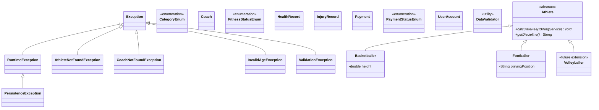
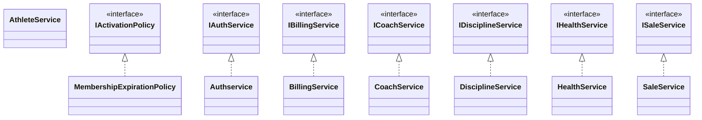

# Hierarchy Diagram

Inheritance (`extends`) and interface realization (`implements`) of **every** class in the project (`com.creatinaboys`), generated from the source code. It is split by area so that each tree can be read. Classes drawn alone do not extend any project class (they only extend `Object`); enums implicitly extend `java.lang.Enum`.

`<<JDK>>` marks classes and interfaces of the Java library (Swing) that are not part of the project.

## 1. Domain model, exceptions and validation

Only `Athlete` has subclasses. Enums, `Coach`, `HealthRecord`, `InjuryRecord`, `Payment`, `UserAccount` and `DataValidator` do not extend any project class. Exceptions extend `java.lang.Exception` (checked) or `RuntimeException` (unchecked).

## 2. Persistence (repositories and parsers)

One interface per repository with its file implementation. `AthleteRepository` is the in-memory implementation. `CoachParser`, `HealthRecordParser`, `PaymentParser`, `AthleteParserRegistry`, `FileStorage` and `TextCodec` are standalone helpers.

```mermaid
classDiagram
    direction TB
    class AthleteParser {
        <<interface>>
    }
    class AthleteParserRegistry
    class AthleteRepository
    class BasketballerParser
    class CoachParser
    class FileAthleteRepository
    class FileCoachRepository
    class FileDisciplineRepository
    class FileHealthRepository
    class FilePaymentRepository
    class FileStorage {
        <<utility>>
    }
    class Fileuserrepository
    class FootballerParser
    class HealthRecordParser
    class IAthleteRepository {
        <<interface>>
    }
    class ICoachRepository {
        <<interface>>
    }
    class IDisciplineRepository {
        <<interface>>
    }
    class IHealthRepository {
        <<interface>>
    }
    class IPaymentRepository {
        <<interface>>
    }
    class Iuserrepository {
        <<interface>>
    }
    class PaymentParser
    class TextCodec {
        <<utility>>
    }

    IAthleteRepository <|.. AthleteRepository
    AthleteParser <|.. BasketballerParser
    IAthleteRepository <|.. FileAthleteRepository
    ICoachRepository <|.. FileCoachRepository
    IDisciplineRepository <|.. FileDisciplineRepository
    IHealthRepository <|.. FileHealthRepository
    IPaymentRepository <|.. FilePaymentRepository
    Iuserrepository <|.. Fileuserrepository
    AthleteParser <|.. FootballerParser
    class VolleyballerParser {
        <<future extension>>
    }
    AthleteParser <|.. VolleyballerParser
```

## 3. Services

Each service implements its interface (DIP). `AthleteService` has no interface; `MembershipExpirationPolicy` is the only implementation of `IActivationPolicy`.

## 4. User interface (Swing)

Every screen extends a Swing component. `Outer_Inner` is an inner class declared inside `Outer`. `Main`, `PrincipalFrame`, `AthleteConsultFrame`, `AthleteRegisterFrame`, `ThemeConstants`, `ModernTable`, `Money`, `SpanishLabels`, `CoachLabels` and `SearchText` do not extend any class.

```mermaid
classDiagram
    direction TB
    class Main
    class AthleteConsultFrame
    class AthleteRegisterFrame
    class LoginFrame
    class PrincipalFrame
    class PrincipalFrames
    class ModernComboBox
    class ModernComboBox_ModernUI
    class ThemeConstants
    class BrandHeader
    class CardPanel
    class ClubLogo
    class CoachLabels {
        <<utility>>
    }
    class IconBadge
    class InputBox
    class LinkLabel
    class ModernButton
    class ModernButton_Style {
        <<enumeration>>
    }
    class ModernTable {
        <<utility>>
    }
    class ModernTable_Badge
    class Money {
        <<utility>>
    }
    class PlaceholderPasswordField
    class PlaceholderTextField
    class SearchText {
        <<utility>>
    }
    class ShareBar
    class SidebarButton
    class SpanishLabels {
        <<utility>>
    }
    class VectorIcon
    class VectorIcon_Type {
        <<enumeration>>
    }
    class AthleteListPanel
    class AthleteListPanel_RoundedPanel
    class AthleteListPanel_BadgeRenderer
    class AthleteListPanel_Badge
    class AthleteListPanel_PageButton
    class AthleteRegisterPanel
    class CategoryPanel
    class CoachFormDialog
    class CoachFormDialog_Saver {
        <<interface>>
    }
    class CoachPanel
    class CoachPanel_IconTextRenderer
    class CoachPanel_ActionsCell
    class CoachPanel_StatusBadge
    class CoachPanel_RoundedPanel
    class CoachPanel_PageButton
    class DisciplinePanel
    class HomePanel
    class HomePanel_ScrollBody
    class HomePanel_Bar
    class HomePanel_Donut
    class HomePanel_Avatar
    class PaymentPanel
    class PaymentPanel_TabButton
    class RegisterPanel
    class ReportsPanel
    class ReportsPanel_TabButton
    class JFrame {
        <<JDK>>
    }
    class JComboBox {
        <<JDK>>
    }
    class BasicComboBoxUI {
        <<JDK>>
    }
    class JPanel {
        <<JDK>>
    }
    class JComponent {
        <<JDK>>
    }
    class JLabel {
        <<JDK>>
    }
    class JButton {
        <<JDK>>
    }
    class JPasswordField {
        <<JDK>>
    }
    class JTextField {
        <<JDK>>
    }
    class Icon {
        <<JDK>>
    }
    class TableCellRenderer {
        <<JDK>>
    }
    class JDialog {
        <<JDK>>
    }
    class DefaultTableCellRenderer {
        <<JDK>>
    }
    class Scrollable {
        <<JDK>>
    }

    JFrame <|-- LoginFrame
    JFrame <|-- PrincipalFrames
    JComboBox <|-- ModernComboBox : JComboBox~String~
    BasicComboBoxUI <|-- ModernComboBox_ModernUI
    JPanel <|-- BrandHeader
    JPanel <|-- CardPanel
    JPanel <|-- ClubLogo
    JComponent <|-- IconBadge
    JPanel <|-- InputBox
    JLabel <|-- LinkLabel
    JButton <|-- ModernButton
    JPanel <|-- ModernTable_Badge
    JPasswordField <|-- PlaceholderPasswordField
    JTextField <|-- PlaceholderTextField
    JComponent <|-- ShareBar
    JButton <|-- SidebarButton
    Icon <|.. VectorIcon
    JPanel <|-- AthleteListPanel
    JPanel <|-- AthleteListPanel_RoundedPanel
    TableCellRenderer <|.. AthleteListPanel_BadgeRenderer
    JPanel <|-- AthleteListPanel_Badge
    JButton <|-- AthleteListPanel_PageButton
    JPanel <|-- AthleteRegisterPanel
    JPanel <|-- CategoryPanel
    JDialog <|-- CoachFormDialog
    JPanel <|-- CoachPanel
    DefaultTableCellRenderer <|-- CoachPanel_IconTextRenderer
    JPanel <|-- CoachPanel_ActionsCell
    JPanel <|-- CoachPanel_StatusBadge
    JPanel <|-- CoachPanel_RoundedPanel
    JButton <|-- CoachPanel_PageButton
    JPanel <|-- DisciplinePanel
    JPanel <|-- HomePanel
    JPanel <|-- HomePanel_ScrollBody
    Scrollable <|.. HomePanel_ScrollBody
    JComponent <|-- HomePanel_Bar
    JComponent <|-- HomePanel_Donut
    JComponent <|-- HomePanel_Avatar
    JPanel <|-- PaymentPanel
    JButton <|-- PaymentPanel_TabButton
    JPanel <|-- RegisterPanel
    JPanel <|-- ReportsPanel
    JButton <|-- ReportsPanel_TabButton

```

`Volleyballer` and `VolleyballerParser` are not implemented: they only show how the hierarchy
and the persistence parsers can grow without modifying existing code (Open/Closed Principle).