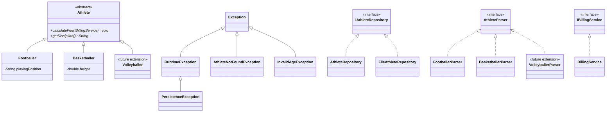

# Hierarchy Diagram

`Volleyballer` and `VolleyballerParser` are not implemented: they only show how the hierarchy
and the persistence parsers can grow without modifying existing code (Open/Closed Principle).